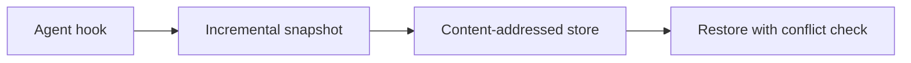

<div align="center">


[](https://github.com/ayushdoesdev/unwreck/actions/workflows/ci.yml)
[](https://crates.io/crates/unwreck)
[](https://crates.io/crates/unwreck)
[](https://github.com/ayushdoesdev/unwreck#license)
[](https://github.com/ayushdoesdev/unwreck/blob/main/code/Cargo.toml)


Demo uses a scripted agent session with the real unwreck hooks. The same thing happens with Codex, Claude Code, and Gemini CLI.

</div>

## Why

Coding agents delete untracked files and rewrite trees through the shell. Claude Code's `/rewind` does **not** track Bash changes ([docs](https://code.claude.com/docs/en/checkpointing)). Codex users have been asking for `/undo` back ([#9203](https://github.com/openai/codex/issues/9203)). unwreck snapshots the working tree *before* those tools run, including `.env` and other small gitignored files, so one command puts the turn back.

## Install

Needs [Rust](https://www.rust-lang.org/tools/install) 1.90+ for `cargo install`. Binaries (no Rust required): Linux musl x86_64, macOS x86_64/aarch64, Windows x86_64. aarch64 Linux is planned for 0.1.1.

```sh
cargo install unwreck
curl -LsSf https://github.com/ayushdoesdev/unwreck/releases/latest/download/unwreck-installer.sh | sh
# Windows (PowerShell)
irm https://github.com/ayushdoesdev/unwreck/releases/latest/download/unwreck-installer.ps1 | iex
```

Or download a build from [GitHub Releases](https://github.com/ayushdoesdev/unwreck/releases).

## 60-second quickstart

```sh
unwreck hooks --write          # Claude Code, Codex, and Gemini CLI (project config)
# use your agent as usual
unwreck undo                   # put the last turn back
unwreck doctor                 # store, hooks, CLIs
```

Codex asks you to review and trust a new hook once. Agents without hooks (aider, scripts):

```sh
unwreck run -- aider
```

## Features

- 🪝 **Before the shell, not after.** Snapshots run on `PreToolUse` / `BeforeTool`, so `rm`, `mv`, and `sed -i` are undoable.
- 📦 **Untracked and ignored.** `.env*` is kept; `node_modules`, `target`, and similar dirs are skipped.
- 🛡️ **Your edits win.** A file you changed after the snapshot is skipped on restore unless you pass `--force` (and `--force` is still redoable).
- 💾 **Local store.** BLAKE3 + zstd, outside the repo. Nothing is uploaded. `.git` is never touched.
- 🖥️ **TUI.** Timeline, file list, and unified diff.


## Command reference

| Command | What it does |
|---|---|
| `unwreck hooks --write` | Merge hook commands into Claude / Codex / Gemini config (`--remove`, `--dry-run`, `--agent`, `--scope`) |
| `unwreck hook <agent>` | Called by the agent (JSON on stdin; always exit 0, empty stdout) |
| `unwreck run -- <cmd…>` | Snapshot around any CLI (`--quiet-ms`, default 1500) |
| `unwreck watch` | Same watcher without spawning a child |
| `unwreck snap [-m msg]` | Manual snapshot (always written) |
| `unwreck log [-n 20]` | Timeline, newest last |
| `unwreck diff [N [M]]` | No args: last turn-start vs disk. One id vs disk. Two ids vs each other. `--patch` for unified diffs |
| `unwreck restore <id>` | Make the tree match that snapshot (`--only`, `--force`, `--dry-run`) |
| `unwreck undo` / `redo` | Last turn boundary / the pre-restore snapshot |
| `unwreck tui` | Interactive restore (`enter` / `u` / `r` / `q`) |
| `unwreck gc [--keep N]` | Drop old snapshots |
| `unwreck doctor [--json]` | Store, hooks, agent CLIs; exit 1 only on fail |

`unwreck --help` and `unwreck <cmd> --help` include examples. Color is off when `NO_COLOR` is set or stdout is not a TTY.

<details>
<summary>Retention (<code>~/.config/unwreck/config.toml</code> or <code>.unwreck.toml</code>)</summary>

```toml
[gc]
keep_turns = 500   # newest N snapshots (default)
keep_days = 30     # also keep anything this new
```

`unwreck gc --keep N` keeps only the newest N for that run. Packs are rewritten only when more than 30% of the file is unreferenced.

</details>

## How it works



- A hook (or a quiet period in `run` / `watch`) scans the tree and records `path → hash`. Duplicate contents are stored once.
- `undo` restores the previous **turn boundary**. Every restore snapshots first, which is what makes `redo` possible.
- Restore never overwrites a file whose bytes changed after the last snapshot, and it never writes inside `.git`.

Design notes: [ARCHITECTURE.md](ARCHITECTURE.md), [PLAN.md](PLAN.md).

## Supported agents

| Agent | How snapshots fire |
|---|---|
| Claude Code | `UserPromptSubmit`, `PreToolUse` (`Bash\|Write\|Edit\|MultiEdit\|NotebookEdit`), `Stop` |
| Codex | `UserPromptSubmit`, `PreToolUse` (matcher `*`), `Stop`. Trust the hook once |
| Gemini CLI | `BeforeAgent`, `BeforeTool` (`run_shell_command\|write_file\|replace`), `AfterAgent` |
| Anything else | `unwreck run -- <cmd>` or `unwreck watch` |

## How it compares

Based on each tool's own docs or README as of 2026-10-18. Corrections welcome.

<details>
<summary>Comparison table</summary>

| | unwreck | Codex `/undo` | Claude Code checkpoints (`/rewind`) | Gemini CLI checkpointing | `git stash` / commits | agent-undo (`au`) | turnback (npm) |
|---|---|---|---|---|---|---|---|
| Available | yes | **removed**; users asking for it back in [openai/codex#9203](https://github.com/openai/codex/issues/9203) | yes, built in | yes, **off by default** | yes | yes | yes (npm v0.9.1) |
| Undoes shell-command changes (`rm`, `mv`, `sed -i`) | yes (snapshot before each tool hook; watcher in `run` mode) | – | **no**, per [docs](https://code.claude.com/docs/en/checkpointing) | triggers on approving file-modifying tools such as `write_file`/`replace`; shell coverage not confirmed | only what you committed or stashed | watches file writes (README) | yes, per its npm description ("including shell commands") |
| Untracked / git-ignored files | untracked yes; ignored `.env*` yes; heavy dirs skipped | – | files edited by its tools | shadow git repo (ignore behaviour not checked) | `stash -u` / `-a` only if you remember | per README, every write | untracked yes, per its npm description; ignored files not checked |
| Works across agents | Claude Code, Codex, Gemini (hooks) + any CLI (`run`/`watch`) | Codex only | Claude Code only | Gemini only | n/a | Claude Code hook + daemon; README lists others | Claude Code, Codex, Cursor, Gemini CLI, OpenCode, Antigravity (per its docs) |
| Protects edits you made afterwards | yes, conflicts skipped unless `--force` | – | – | – | n/a | not documented | not checked |
| Restores conversation too | **no** (by design) | – | yes | yes | no | no | not checked |
| Windows | CI from v0.1 (smoke script is bash-only, skipped on Windows) | n/a (built into Codex) | n/a (built in) | n/a (built in) | yes | README lists macOS/Linux binaries | not checked |
| Needs a background daemon | no | n/a | n/a | n/a | no | yes (`au serve`) | not checked (hooks + CLI + MCP server; needs Node.js) |

turnback covers more agents than unwreck does today and adds `blame`/`recover` and an MCP server. unwreck is a single Rust binary with no runtime dependency, and its restore skips files you've edited since (conflict-aware). Pick whichever fits.

</details>

## Performance

Measured on this box with `scripts/bench.sh`, `BENCH_AGE=1`, release build, 20 runs, 10,000 files / 40 MB:

| | ms |
|---|---|
| First snapshot | 727.4 |
| Unchanged hook snapshot p50 | 27.7 |
| Unchanged hook snapshot p95 | 29.4 |
| Store after that snapshot (`du -sk`) | 3512 KiB |

Budget for an unchanged 10k-file hook snapshot is p50 ≤ 30 ms.

## FAQ

**Is my data sent anywhere?** No. There is no telemetry and no network client in the snapshot path. Files stay in the local store (`$UNWRECK_DIR` or the platform data directory under `projects/<hash>`).

**Does it touch `.git`?** No. Restore never writes inside `.git`. If an agent ran `git reset --hard`, unwreck can put your files back; use `git reflog` for branches and refs.

**Disk usage?** Identical contents are stored once (BLAKE3) and compressed (zstd). The 10k-file / 40 MB bench tree used 3512 KiB on disk after the first snapshot. Default retention is 500 newest snapshots and 30 days; `unwreck gc` drops the rest.

## Limitations

- It does not restore chat history. Use the agent's own resume/rewind for that.
- Files over 16 MiB (configurable) are recorded as too large and show up as `MISSING` on restore instead of being silently dropped.
- It does not replace version control. Commit early, commit often.

## Contributing

See [CONTRIBUTING.md](CONTRIBUTING.md). The Cargo workspace is `code/`. Re-record the GIFs with `scripts/record-demo.sh` (needs [VHS](https://github.com/charmbracelet/vhs)).

## License

[MIT](LICENSE-MIT) OR [Apache-2.0](LICENSE-APACHE)
