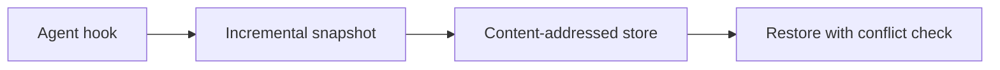

<div align="center">


[](https://github.com/ayushdoesdev/unwreck/actions/workflows/ci.yml)
[](https://crates.io/crates/unwreck)
[](https://crates.io/crates/unwreck)
[](https://github.com/ayushdoesdev/unwreck#license)
[](https://github.com/ayushdoesdev/unwreck/blob/main/code/Cargo.toml)


Demo uses a scripted agent session with the real unwreck hooks. The same thing happens with Codex, Claude Code, and Gemini CLI.

</div>

## Overview

unwreck keeps local snapshots of your working tree so you can undo changes made by coding agents. Hooks capture changes before supported tools run, including shell commands and edits to untracked files. You can also run unwreck around another command with `unwreck run`.

## Install

Needs [Rust](https://www.rust-lang.org/tools/install) 1.90+ for `cargo install`. Prebuilt binaries are available for Linux musl x86_64, macOS x86_64/aarch64, and Windows x86_64.

```sh
cargo install unwreck
curl -LsSf https://github.com/ayushdoesdev/unwreck/releases/latest/download/unwreck-installer.sh | sh
# Windows (PowerShell)
irm https://github.com/ayushdoesdev/unwreck/releases/latest/download/unwreck-installer.ps1 | iex
```

Or download a build from [GitHub Releases](https://github.com/ayushdoesdev/unwreck/releases).

## Quick start

```sh
unwreck hooks --write          # Claude Code, Codex, and Gemini CLI (project config)
# use your agent as usual
unwreck undo                   # put the last turn back
unwreck doctor                 # store, hooks, CLIs
```

Codex asks you to review and trust a new hook once. Agents without hooks (aider, scripts):

```sh
unwreck run -- aider
```

## What it does

- Hooks run before supported tools, so shell changes such as `rm` and `mv` can be undone.
- Untracked files and selected ignored files such as `.env` are included. Large generated directories such as `node_modules` and `target` are skipped.
- Restore skips files changed since the snapshot unless you use `--force`.
- Snapshots are stored locally, outside the repository. unwreck does not write inside `.git`.
- The TUI shows the snapshot timeline, changed files, and diffs.


## Command reference

| Command | What it does |
|---|---|
| `unwreck hooks --write` | Merge hook commands into Claude / Codex / Gemini config (`--remove`, `--dry-run`, `--agent`, `--scope`) |
| `unwreck hook <agent>` | Called by the agent (JSON on stdin; always exit 0, empty stdout) |
| `unwreck run -- <cmd…>` | Snapshot around any CLI (`--quiet-ms`, default 1500) |
| `unwreck watch` | Same watcher without spawning a child |
| `unwreck snap [-m msg]` | Manual snapshot (always written) |
| `unwreck log [-n 20]` | Timeline, newest last |
| `unwreck diff [N [M]]` | No args: last turn-start vs disk. One id vs disk. Two ids vs each other. `--patch` for unified diffs |
| `unwreck restore <id>` | Make the tree match that snapshot (`--only`, `--force`, `--dry-run`) |
| `unwreck undo` / `redo` | Last turn boundary / the pre-restore snapshot |
| `unwreck tui` | Interactive restore (`enter` / `u` / `r` / `q`) |
| `unwreck gc [--keep N]` | Drop old snapshots |
| `unwreck doctor [--json]` | Store, hooks, agent CLIs; exit 1 only on fail |

`unwreck --help` and `unwreck <cmd> --help` include examples. Color is off when `NO_COLOR` is set or stdout is not a TTY.

<details>
<summary>Retention (<code>~/.config/unwreck/config.toml</code> or <code>.unwreck.toml</code>)</summary>

```toml
[gc]
keep_turns = 500   # newest N snapshots (default)
keep_days = 30     # also keep anything this new
```

`unwreck gc --keep N` keeps only the newest N for that run. Packs are rewritten only when more than 30% of the file is unreferenced.

</details>

## How it works



- A hook (or a quiet period in `run` / `watch`) scans the tree and records `path → hash`. Duplicate contents are stored once.
- `undo` restores the previous **turn boundary**. Every restore snapshots first, which is what makes `redo` possible.
- Restore never overwrites a file whose bytes changed after the last snapshot, and it never writes inside `.git`.

## Supported agents

| Agent | How snapshots fire |
|---|---|
| Claude Code | `UserPromptSubmit`, `PreToolUse` (`Bash\|Write\|Edit\|MultiEdit\|NotebookEdit`), `Stop` |
| Codex | `UserPromptSubmit`, `PreToolUse` (matcher `*`), `Stop`. Trust the hook once |
| Gemini CLI | `BeforeAgent`, `BeforeTool` (`run_shell_command\|write_file\|replace`), `AfterAgent` |
| Anything else | `unwreck run -- <cmd>` or `unwreck watch` |

## Performance

Measured on this box with `scripts/bench.sh`, `BENCH_AGE=1`, release build, 20 runs, 10,000 files / 40 MB:

| | ms |
|---|---|
| First snapshot | 727.4 |
| Unchanged hook snapshot p50 | 27.7 |
| Unchanged hook snapshot p95 | 29.4 |
| Store after that snapshot (`du -sk`) | 3512 KiB |

## FAQ

**Is my data sent anywhere?** No. There is no telemetry and no network client in the snapshot path. Files stay in the local store (`$UNWRECK_DIR` or the platform data directory under `projects/<hash>`).

**Does it touch `.git`?** No. Restore never writes inside `.git`. If an agent ran `git reset --hard`, unwreck can put your files back; use `git reflog` for branches and refs.

**Disk usage?** Identical contents are stored once and compressed. By default, unwreck keeps the newest 500 snapshots and snapshots from the last 30 days; `unwreck gc` removes older ones.

## Limitations

- It does not restore chat history. Use the agent's own resume/rewind for that.
- Files over 16 MiB (configurable) are recorded as too large and show up as `MISSING` on restore instead of being silently dropped.
- It does not replace version control. Commit early, commit often.

## Contributing

See [CONTRIBUTING.md](https://github.com/ayushdoesdev/unwreck/blob/main/CONTRIBUTING.md). The Cargo workspace is `code/`. Re-record the GIFs with [`scripts/record-demo.sh`](https://github.com/ayushdoesdev/unwreck/blob/main/scripts/record-demo.sh) (needs [VHS](https://github.com/charmbracelet/vhs)).

## License

[MIT](https://github.com/ayushdoesdev/unwreck/blob/main/LICENSE-MIT) OR [Apache-2.0](https://github.com/ayushdoesdev/unwreck/blob/main/LICENSE-APACHE)
